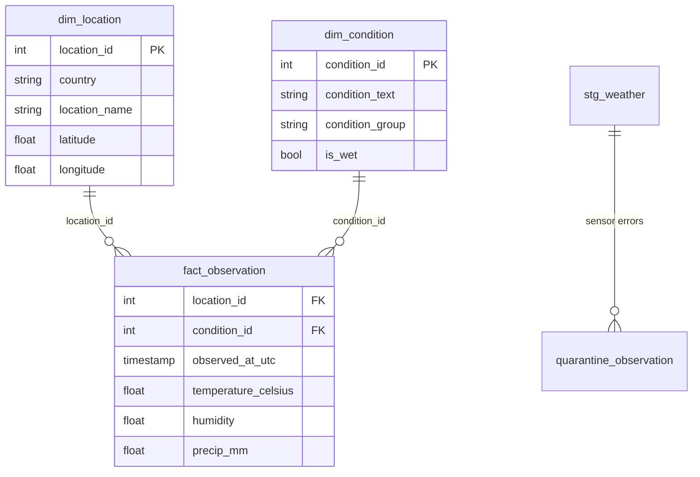

# Global weather: SQL pipeline, data-quality checks and a fair model benchmark

[](https://github.com/MaHmOuDeB/weather-sql-pipeline/actions/workflows/ci.yml)


A small, tested data pipeline over 8,725 weather observations from 236 locations in 191 countries (16 May to 28 Jun 2024): raw
CSV, staging, a star schema, automated data-quality checks with a quarantine for sensor errors, descriptive statistics with
honest uncertainty, and a rain classifier scored on places it has never seen.

*Rebuilt in 2026 from my Master's project "Data Engineering and Business Analytics" (2024). Rebuilding it turned up a real problem
in the first version: it predicted each target from all the other columns, including that target's own unit twin (temperature in
Fahrenheit for Celsius, visibility in miles for kilometres), which is why it reported errors close to zero. It also scaled the
data before splitting, a smaller flaw of the same kind. This version removes both.*

**What this shows:** the habits that matter on messy business data, not the weather: reconcile every row, quarantine bad
readings instead of keeping them, test the checks themselves, report uncertainty that matches how the data was collected, and
distrust results that look too good.

## Results at a glance

| Question | Answer |
|---|---|
| Is the data clean? | After quarantining 5 sensor errors (winds of 172 to 2,963 km/h reported as "partly cloudy" at ordinary pressure) all error-level checks pass. 43 of 236 locations have fewer than 20 observations |
| What does weather change? | Temperature barely depends on the condition (effect size 0.04); where a place is matters more (R-squared 0.04 to 0.19 with latitude). Within one place, humidity falls as temperature rises (rho -0.62) |
| Can a model tell when it is raining? | Moderately. XGBoost reaches F1 0.52 and ROC AUC 0.91 on places it never saw, about the same as Random Forest. "Always dry" scores 90% accuracy but F1 = 0 |
| What does a data leak look like? | Predicting Celsius with a Fahrenheit column gives R-squared 1.00; without it, 0.79 |


## Pipeline



| Step | What it does |
|---|---|
| `sql/01_staging.sql` | Typed, snake_case table; trims text and lower-cases conditions; keeps the Fahrenheit and mph columns only to prove they are exact conversions |
| `sql/02_model.sql` | `dim_location` (236), `dim_condition` (27, with a condition group and a wet/dry flag), `fact_observation` (8,720), `quarantine_observation` (5) |
| `sql/03_checks.sql` | 18 checks: row reconciliation, key uniqueness, missing values, one coordinate pair per place, value ranges, unit consistency, plausibility. `error` checks stop the pipeline; `warn` and `info` are reported |

`src/pipeline.py` builds into a temporary file and writes `data/warehouse.duckdb` only if every error-level check passes. Column
meanings are in [docs/data_dictionary.md](docs/data_dictionary.md). The wet/dry flag leaves "rain nearby" and "rain possible" as
unknown, and those rows form their own condition group, so the statistics and the classifier use the same definition of rain.

`tests/` runs the same SQL on a small synthetic file and proves that the checks catch impossible humidity, missing values,
duplicate observations and mismatched units, that implausible winds are quarantined, that the label logic and spelling merge work,
and that a failing build leaves no warehouse behind.

## Descriptive statistics

Rows from the same place are not independent (about 37 observations per place), so intervals come from resampling places, not
rows, and no p-values are reported; the effect sizes are descriptive.

**Sanity checks.** The condition text is derived from visibility and precipitation, so these differences are expected by construction:
fog and mist have a median visibility of 4 km versus 10 km for other conditions (epsilon-squared 0.19), and rain and thunder a
median of 0.31 mm of precipitation versus 0 (epsilon-squared 0.31).

**Findings.**

| Question | Answer |
|---|---|
| Does temperature differ by condition? | Barely (epsilon-squared 0.04; medians 27.1 C clear versus 24.0 C rain). Adding latitude lifts R-squared from 0.04 to 0.19: where a place is matters more than the weather it is having |
| UV index versus cloud cover | Negative: Spearman rho -0.41 (95% CI -0.47 to -0.34). Using only 10:00 to 15:59 local time gives -0.40, and within a place over time it is -0.31 (-0.35 to -0.27), so part of the pooled relation is differences between places |
| Temperature versus humidity | Pooled rho -0.35 (-0.44 to -0.25), but -0.62 (-0.65 to -0.58) within one place over time. Comparing places hides how tightly the two move together at a single place |


## Rain classifier, tested fairly

Target: is it raining, drizzling, showering or thundering right now (10% of 8,158 labelled rows). Features exclude precipitation
and the condition text, since they define the target. Folds are grouped by location, so every model is scored on places it has
never seen. Accuracy alone says nothing here, so the table leads with F1 on the rain class and ROC AUC.

| Model (held-out places, 5 folds, mean ± sd) | F1 (rain) | ROC AUC | Avg precision | Accuracy |
|---|---|---|---|---|
| Always predict dry | 0.00 | 0.50 | 0.10 | 0.899 |
| k-NN | 0.28 ± 0.05 | 0.86 ± 0.03 | 0.42 ± 0.04 | 0.905 |
| Random Forest | 0.46 ± 0.05 | 0.91 ± 0.02 | 0.59 ± 0.05 | 0.919 |
| XGBoost | 0.52 ± 0.06 | 0.91 ± 0.02 | 0.59 ± 0.05 | 0.923 |

k-NN is clearly worse; Random Forest and XGBoost cannot be told apart at this sample size, and F1 is at the default 0.5 threshold,
untuned. Splitting rows at random instead of by place flatters Random Forest (F1 0.53 versus 0.46) and k-NN (0.34 versus 0.28) but
barely changes XGBoost. Latitude and longitude identify a place, so a model scored on rows from places it trained on can partly
recognise them. An F1 of about 0.5 still means many rain cases are missed or false alarms, so I would not use this as a forecast.

## The leakage trap

Predicting temperature in Celsius with a random forest, held-out places:

| Features | R-squared |
|---|---|
| Humidity, cloud, pressure, wind, visibility, UV, latitude, longitude, local hour | 0.79 |
| The same plus temperature in Fahrenheit | 1.00 |

The jump to 1.00 is not skill: Fahrenheit is the same number in other units. This case is obvious on purpose; the habit it
illustrates is to check what the model can see whenever a score looks too good.

## Limits

- Six weeks of data and about one observation a day per place, so this says nothing about seasons or forecasting.
- Conditions are the weather service's text labels, not ground truth, and the wet label is a judgement call (documented above).
- The 150 km/h quarantine threshold is a judgement call; all five rows it removes are implausible on their own evidence.
- The first version of this project used a standardised copy of the data; this one works in the original units.

## Reproduce

Download Kaggle's *Global Weather Repository* (check the dataset page for the licence) and save it as
`data/GlobalWeatherRepository.csv`; the raw file is not in this repo. Then:

```bash
make setup      # pip install -r requirements.txt
make pipeline   # builds data/warehouse.duckdb, runs the checks, writes reports/quality.json
make analysis   # statistics and the benchmark -> reports/results.json, reports/figures/
make test
```

Results are reproducible: fixed seeds and a fixed row order give identical output on every run.

Data: Kaggle, *Global Weather Repository* (daily snapshots from WeatherAPI.com).
