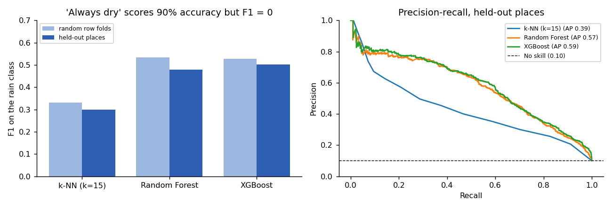
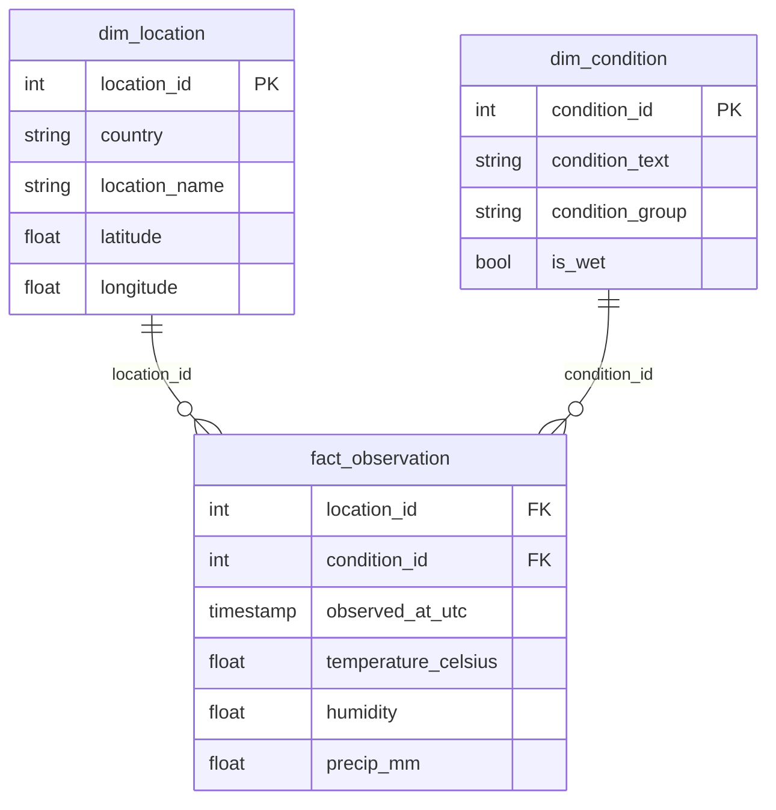
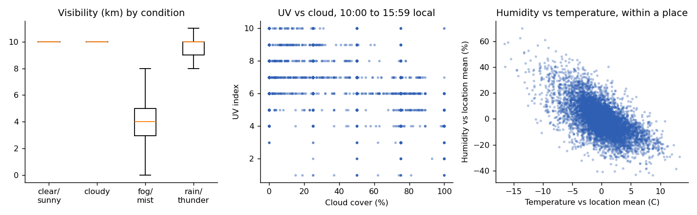

# Global weather: SQL pipeline, data-quality checks and a fair model benchmark

[](https://github.com/MaHmOuDeB/weather-sql-pipeline/actions/workflows/ci.yml)


A small, tested data pipeline over 8,725 weather observations from 236 locations in 191 countries (16 May to 28 Jun 2024):
raw CSV, staging, star schema, automated data-quality checks, five statistical questions with effect sizes, and a rain
classifier that is scored on places it has never seen.

*Rebuilt in 2026 from my Master's project "Data Engineering and Business Analytics" (2024). Rebuilding it turned up a real
problem in the first version: it predicted each target from all the other columns, including that target's own unit twin
(temperature in Fahrenheit for Celsius, visibility in miles for kilometres), and it scaled the data before splitting. That is
why it reported errors close to zero. This version removes the leak and shows its effect.*

## Results at a glance

| Question | Answer |
|---|---|
| Is the data clean? | All error-level checks pass. 5 wind readings above 150 km/h are flagged for review, 43 of 236 locations have fewer than 20 observations, and one condition appears under two spellings |
| What changes with the weather? | Visibility (fog and mist: 4 km median versus 10 km) and precipitation clearly; temperature barely (effect size 0.04). Where a place is matters more than the weather it is having |
| Can a model tell when it is raining? | Moderately. XGBoost reaches F1 0.50 and ROC AUC 0.91 on places it never saw; "always dry" already scores 90% accuracy but F1 = 0 |
| What does a data leak look like? | Predicting Celsius with a Fahrenheit column gives R-squared 0.999; without it, 0.77 |



## Pipeline



| Step | What it does |
|---|---|
| `sql/01_staging.sql` | Typed, snake_case table; trims text and lower-cases conditions; drops the redundant Fahrenheit, mph, inch and mile columns (kept only to prove they are exact conversions) |
| `sql/02_model.sql` | `dim_location` (236 rows), `dim_condition` (27, with a condition group and a wet/dry flag), `fact_observation` (8,725) |
| `sql/03_checks.sql` | 16 checks: row counts, key uniqueness, missing keys, value ranges, unit consistency, plausibility. `error` checks stop the pipeline; `warn` and `info` are reported |

Column meanings are in [docs/data_dictionary.md](docs/data_dictionary.md). The wet/dry flag leaves "rain nearby" and "rain
possible" as unknown, since they do not say it is raining at the location.

`tests/` runs the same SQL on a small synthetic file and proves that the checks catch impossible humidity, duplicate
observations and mismatched units, and that the label logic and the spelling merge work.

## Five questions, with effect sizes

| Question | Answer |
|---|---|
| Does visibility differ by condition? | Yes. Fog and mist have a median of 4 km versus 10 km for clear and cloudy (Kruskal-Wallis, epsilon-squared 0.18) |
| Does precipitation differ by condition? | Yes, the largest effect (epsilon-squared 0.36). Median 0.13 mm in rain and thunder, 0 elsewhere |
| Does temperature differ by condition? | Barely (epsilon-squared 0.04; medians 27.1 C clear versus 24.8 C rain). Adding latitude lifts R-squared from 0.04 to 0.20, so *where* a place is matters more than the weather it is having |
| UV index versus cloud cover | Moderate negative relation: Spearman rho -0.41 (95% CI -0.43 to -0.39). Using only 10:00 to 15:59 local time gives -0.40, so it is not a day/night artefact |
| Temperature versus humidity | Pooled rho -0.35, but -0.62 within one place over time. Comparing places hides how tightly the two move together at a single place |



## Rain classifier, tested fairly

Target: is it raining, drizzling, showering or thundering right now (10% of 8,163 labelled rows). Features exclude
precipitation and the condition text, since they define the target. Folds are grouped by location, so every model is scored on
places it has never seen. Accuracy alone says nothing here, so the table leads with F1 on the rain class and ROC AUC.

| Model (held-out places, 5 folds, mean ± sd) | F1 (rain) | ROC AUC | Avg precision | Accuracy |
|---|---|---|---|---|
| Always predict dry | 0.00 | 0.50 | 0.10 | 0.900 |
| k-NN | 0.30 ± 0.05 | 0.84 ± 0.01 | 0.40 ± 0.02 | 0.905 |
| Random Forest | 0.48 ± 0.05 | 0.90 ± 0.02 | 0.58 ± 0.03 | 0.921 |
| XGBoost | 0.50 ± 0.04 | 0.91 ± 0.01 | 0.59 ± 0.02 | 0.922 |

Splitting rows at random instead of by place flatters the models a little (XGBoost F1 0.53 versus 0.50), because each
place has few observations. XGBoost is best, but an F1 of 0.5 still means many rain cases are missed or false alarms, so I would
not use it as a forecast.

## The leakage trap

Predicting temperature in Celsius with a random forest, held-out places:

| Features | R-squared |
|---|---|
| Humidity, cloud, pressure, wind, visibility, UV, latitude, longitude, local hour | 0.77 |
| The same plus temperature in Fahrenheit | 0.999 |

The jump to 0.999 is not skill: Fahrenheit is the same number in other units. Any near-perfect score should trigger a check
of what the model can see.

## Limits

- Six weeks of data and about one observation a day per place, so this says nothing about seasons or forecasting.
- Conditions are the weather service's text labels, not ground truth, and the wet label is a judgement call (documented above).
- The first version of this project used a standardised copy of the data; this one works in the original units.

## Reproduce

Download Kaggle's *Global Weather Repository* (check the dataset page for the licence) and save it as
`data/GlobalWeatherRepository.csv`; the raw file is not in this repo. Then:

```bash
make setup      # pip install -r requirements.txt
make pipeline   # builds data/warehouse.duckdb, runs the checks, writes reports/quality.json
make analysis   # statistics and the benchmark -> reports/results.json, reports/figures/
make test
```

Results are reproducible: fixed seeds and a fixed row order give identical output on every run.

Data: Kaggle, *Global Weather Repository* (daily snapshots from WeatherAPI.com).
